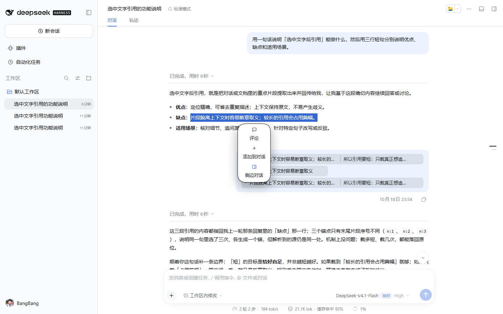
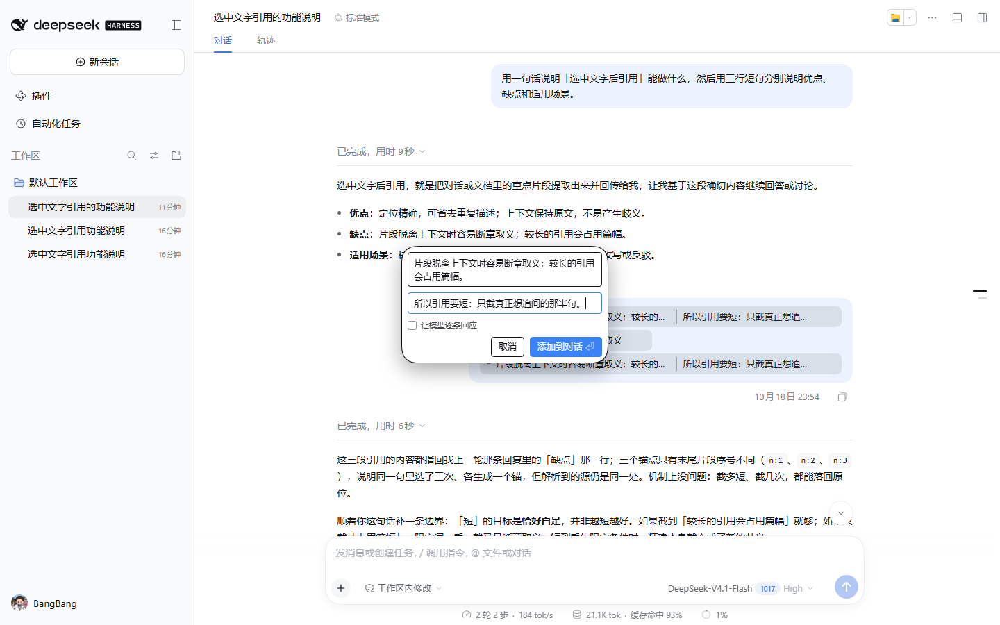
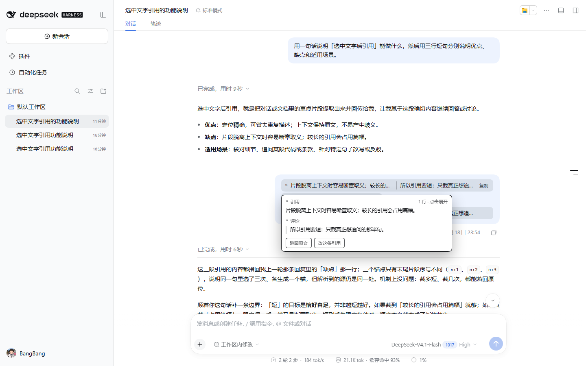
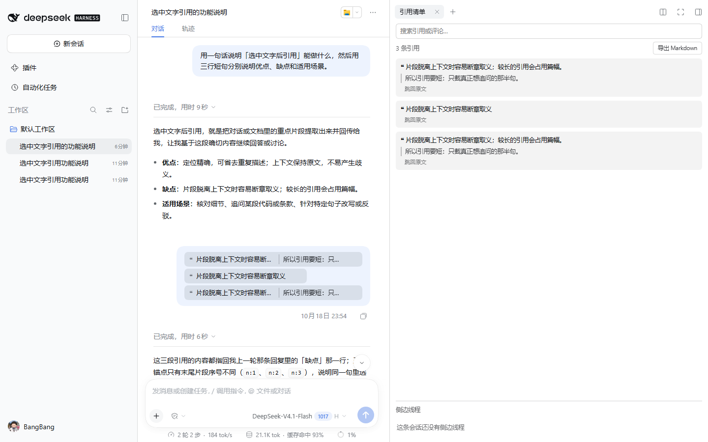
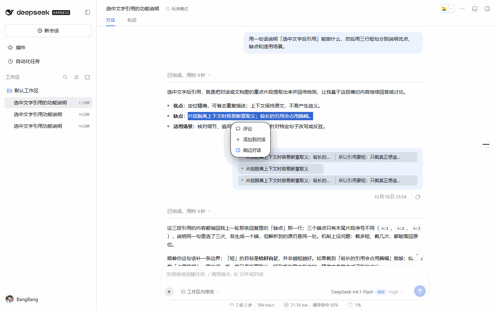

# dsh-client-ui-quote

[](https://www.npmjs.com/package/dsh-client-ui-quote)
[](https://www.npmjs.com/package/dsh-client-ui-quote)
[](https://github.com/BangBang-03/dsh-client-ui-quote/actions/workflows/test.yml)

> 在 DSH 里**选中一段文字**，浮层给出「评论 / 添加到对话 / 侧边对话」。引用以 DSH 原生 `reference-chip` 进输入框，发送后合成**一颗胶囊**，并在原文留下高亮与序号。
> 之后可以跳回原文、复制为 Markdown、在右侧栏**引用清单**里搜索 / 审阅 / 导出，也可以把**侧边线程**的结论带回主会话。
> **所有路径只写草稿、绝不代发**；引用内容不出本机。

[设计说明](docs/design.md) · [自检细节](docs/testing.md) · [开发与发布](docs/release.md) · [English](docs/README.en.md) · [贡献](CONTRIBUTING.md)

## 30 秒上手

1. 安装：桌面版在应用内插件页搜索 `dsh-client-ui-quote`，或 `dsh plugin --profile desktop add dsh-client-ui-quote`。
2. 在消息、文件预览、终端或 diff 里**选中文字**，浮层选「评论」或「添加到对话」。
3. 发送后回原文看高亮；悬停胶囊可**跳回**、可**复制为 Markdown**；右侧栏「引用清单」（桌面 `Alt+L`）可搜索、导出、审阅。

## 界面

| 划词浮层 | 评论：引用与评论各一格，都能改 |
| --- | --- |
|  |  |

| 发送后的胶囊 + 悬停卡片 | 右侧栏的「引用清单」页 |
| --- | --- |
|  |  |

四张界面轮播（24 秒，静态截图合成，非实时录屏）：



素材说明见 [`docs/screenshots/README.md`](docs/screenshots/README.md)。

## 功能一览

| 能力 | 行为 |
| --- | --- |
| **划词浮层** | 选区下方浮出「评论 / 添加到对话 / 侧边对话」，贴选区摆放，配色从宿主取样、深浅主题都适配；文案随界面语言（zh / en / ru）。 |
| **评论** | 浮层就地变评论框：引用正文与评论各一格、都能改；`Enter` 提交、`Esc` 关闭、空内容禁用确认；可选「让模型逐条回应」。 |
| **添加到对话** | 引用落到草稿最上方，输入框里已有的文字另起一行接在下面，光标停在末尾。 |
| **侧边对话** | 引用写进一条独立侧边线程的草稿。默认由宿主半建隐藏子会话（`origin: "subagent"`，不在会话列表）并注入一条隐性上下文；宿主半不可用退回 `sessions.fork`；`sideChatBackend: "better"` 时优先 dsh-better-sidebar。三种后端都**不发送**，一条主会话只开一条线程。 |
| **草稿芯片与聚合条** | 引用是原生行内芯片；输入框上方 `引用 ×N` 聚合条支持逐条跳回、`✎` 编辑、`×` 移除（优先宿主 `consumeToken` 精确删除，退回聚焦 + 退格）。 |
| **发送后胶囊** | 引用与评论合成一颗胶囊留在消息里；悬停出全文卡片，可展开、可复制；一条消息多处引用就是多颗胶囊，中间原话位置不变。 |
| **原文高亮与跳回** | 原句留下高亮与序号，**回合回复结束后自动收回**（`keepHighlight: true` 可常亮）；`跳回原文` 把来源消息停到视野上方 24px 并闪一下。 |
| **引用清单** | 右侧栏页面：搜索、跳回、单条复制 / `导出 Markdown`、`导出 JSON`、`待处理 / 已解决` 与 `#标签`、批量插入，底部是侧边线程回流与宿主自检。 |
| **修订与逐条回应** | `改这条引用` 追加一条新引用并给旧胶囊挂 `已修订`；勾选逐条回应后，回复里的 `「引用N」` / `「Quote N」` 变成可悬停、可跳回的小徽章。 |
| **来源识别** | 正文、文件预览、终端、diff、聊天代码块都能划选；代码类来源按围栏代码块发给模型，预览与 diff 还带上探测到的路径、行号，卡片里可直接打开文件。 |
| **快捷键** | 桌面默认 `Alt+Q` 引用 / `Alt+C` 评论 / `Alt+B` 侧边对话 / `Alt+L` 清单，均可在设置里改；Web 无默认绑定，命令仍列在设置中。 |

## 安装

要求 DSH ≥ 0.2.0-rc.2 的 **web / 桌面**客户端（`engines.dsh` 只有下限、没有上限，0.2.2-rc.1 已复核）。稳定版当前 **0.14.2**。

```bash
dsh plugin --profile desktop add dsh-client-ui-quote
```

开发时用 `dsh plugin --profile desktop add link:<clone-path>`，改完刷新即生效；日常运行请用 npm 包。手工注册时把 `"dsh-client-ui-quote": "^0.14.2"` 写进 profile 的 `dependencies`、`dsh.profile.bundles` 追加同名条目再重启（包自带 `cordis.patch.yml`，不用手写 loader）；卸载就是移除这两处。完整流程见 [`docs/release.md`](docs/release.md)。

## 目录结构

每个目录都有自己的 `README.md`，写清该目录的职责、文件清单与改动约定；根 README 只做索引与验收口径。

| 路径 | 作用 |
| --- | --- |
| `lib/` | 插件两个出口：`client.js` 承载客户端全部功能，`index.js` 是宿主半、只做隐藏侧聊线程。见 [`lib/README.md`](lib/README.md)。 |
| `locale/` | 插件页卡片的 zh / en / ru 元数据；界面词条在 `client.js` 的词典里。见 [`locale/README.md`](locale/README.md)。 |
| `test/` | 四套离线断言（776 组）、DOM 垫片与真浏览器版。见 [`test/README.md`](test/README.md)。 |
| `docs/` | 设计、自检、发布、市场材料与英文版。见 [`docs/README.md`](docs/README.md)。 |
| `docs/screenshots/` | 本页「界面」一节用到的截图与轮播 GIF。见 [`docs/screenshots/README.md`](docs/screenshots/README.md)。 |
| `skills/` | 仓库内 agent 流程（文档同步 / 发版），不随 npm 包发布。见 [`skills/README.md`](skills/README.md)。 |
| `submission/` | 插件市场投稿条目。见 [`submission/README.md`](submission/README.md)。 |
| `.github/` | CI / 发布工作流与 PR 模板。见 [`.github/README.md`](.github/README.md)。 |
| 根目录 | `package.json`（清单 + `files` 白名单）、`cordis.patch.yml`（组合包补丁）、`icon.svg`、`AGENTS.md`（红线 + 路由表）、`CONTRIBUTING.md`、`CHANGELOG.md`。 |

## 配置

开关存在本机 `localStorage` 的 `dsh-client-ui-quote:v1:config`，白名单键，类型不符或越界一律丢弃：

| 键 | 默认 | 作用 |
| --- | --- | --- |
| `minChars` | `1` | 选区短于这个字数就不弹浮层。 |
| `maxQuoteChars` | `4000` | 引用超长时截断并提示；`0` 表示不限。 |
| `replyByDefault` | `false` | 「让模型逐条回应」是否默认勾上。 |
| `attribution` | `true` | 是否把可读来源头（`引自第 N 轮 · 助手`）写进线格式。 |
| `highlight` | `true` | 是否绘制原文侧高亮。 |
| `keepHighlight` | `false` | 回合结束后是否保留高亮与序号（坐标始终保留）。 |
| `sideChatBackend` | `"native"` | 侧边对话后端：`"native"` 优先宿主半隐藏线程，`"better"` 优先 dsh-better-sidebar；两者都不要求安装 better-sidebar。 |
| `language` | `"auto"` | `"auto"` 跟随宿主，或固定 `"zh"` / `"en"` / `"ru"`。 |

调试句柄 `window.__dshQuote`：`config()` 看开关、`setConfig({...})` 改开关、`state()` 看浮层状态、`probe()` 看宿主服务可见性与 `lastFailure`（只记阶段与原因，不记引用正文，可直接贴进 issue）。

## 自检

```bash
node --check lib/client.js
npm test          # check + capsule + panel + host，776 组
```

合计 **776 组**（check 12 + capsule 554 + panel 163 + host 47），`npm test` 全绿；`.github/workflows/test.yml` 在每次 push / PR 上用 Node 18/20/22 各跑一遍。真浏览器版 `test/capsule.html` 共 51 项。四套断言各自覆盖什么、怎么跑、坑在哪，见 [`docs/testing.md`](docs/testing.md)。

## 已知限制

- **DSH 兼容是开区间**：`engines.dsh` 为 `>=0.2.0-rc.2`，只有下限（0.2.2-rc.1 复核通过）。宿主改内部接口时表现为静默降级，升级后请跑 `npm test` 与一次侧聊探针；**不要写上界**，否则下一次 rc 会被 DSH 直接禁用。
- **依赖宿主内部契约**（app.asar 0.2.1-rc.3 首次实测、0.2.2-rc.1 复核）：客户端依赖 `conversation.input.overlay`、`inputTriggers.registerSource`、`insertReference` / `consumeToken`、scoped `slash/input-insert-reference`、`sessions.fork` / `sessions.retain`、`sidebarRightTabs` / `sidebarRight.openResource`、`reference-chip`、`conversation.chat.turnTail`；宿主半依赖 `webServer.register` / `connection.requestRejection` / `agents.create` / `subagent/descriptor` v3。缺哪一项就按回退链降级，不会让插件整体挂掉。
- **隐藏线程的种子形状是硬契约**：一个收口回合（`turn/start` → `step/start` → 空 `system/message` 头 → 隐性上下文 → `step/end` → `turn/end`）+ `subagent/descriptor`；第一个 surface 节点必须是 system 头，descriptor 必须排在继承切点之后，否则历史打不开（`subagent/not-resumable`）。客户端用形状版本戳只复用自己建过的线程，旧线程点一次即重建。
- **「改这条引用」是追加，不是原地编辑**：DSH 的 transcript 只追加、没有编辑 API；修订发出一条新引用，旧胶囊挂 `已修订`（本机 `localStorage`，按 `ref + 原文` 归一键，上限 60 条）。
- **线格式只增不改**：`> ❝ …` / `> ❞ …` / `> ※ 指令：…` / `> ※ 引自第 N 轮 · 助手 │q1:…`；标记形状的正文会转义，旧消息没有转义层仍按旧规则读。代码引用靠首行围栏识别，收尾围栏必须成对。
- **路径与行号是 DOM 探测**：文件预览、diff、聊天代码块拿不到宿主标注时就不带，引用本身不受影响；Markdown 预览没有源码行锚点。宿主换渲染形状时只会丢这些附加信息。
- **跨消息的选区不带来源头**：起点与终点分属不同消息时照常发出，但不写 `引自第 N 轮`、也不带可跳回坐标——一句话横跨两轮时任何单一轮次都是错的。
- **高亮依赖 `CSS.highlights`**：支持时由浏览器直接绘制（滚动、流式输出都跟手），不支持时退回浮层只画序号；行不在视口、文字已变、宿主不给 `Range` 时静默跳过，绝不改宿主 DOM。回合尾槽位缺失时高亮保持常亮（等同 `keepHighlight: true`）。
- **浮层层级夹在宿主之间**：宿主设置面板的背景是 `z-index:1000`、宿主 toast 是 1100（`dsh-web-frontend` 资源 CSS，0.2.2 实测）；本插件的聚合条、划词栏、toast、悬停卡片固定在 980–983，不会盖住设置面板。宿主若调整层级，只影响遮挡顺序，不影响引用本身。
- **侧边对话与主会话记忆不互通**：只带创建时最近几轮的快照（上限 8000 字），之后互不同步；回答要回来，只能在清单页点「带回主会话」（写成草稿，不发送）。
- **清单数据来自事件日志 + 本机索引**：历史分页，更早的要点「加载更早的消息」；上下文压缩裁掉的消息靠本机索引兜住，只在本机、不跨设备。右侧栏服务缺失时页面不注册，`Alt+L` 只给一条 toast。
- **没装插件的窗口会看到线格式原文**：胶囊是客户端增强层，另一个 profile 或插件被停用的窗口会原样显示 `> ❝ …`；插件加载与窗口唤醒时会重扫补画。
- 仅 web / 桌面 profile；输入框内的选区属于改稿、不触发；收起状态的胶囊是单行，长引用会被省略号截断（悬停或点开可看全文）。

完整的宿主契约、回退链与设计取舍见 [`docs/design.md`](docs/design.md)。

## 贡献

PR 目标分支是 `main`，标题写成 `fix(quote): 中文说明` 这类口径（squash 后就是主干提交标题）；提交前跑 `node --check lib/client.js && npm test`。规则见 [`CONTRIBUTING.md`](CONTRIBUTING.md)，红线见 [`AGENTS.md`](AGENTS.md)，变更见 [`CHANGELOG.md`](CHANGELOG.md)。

## License

[MIT](LICENSE)
