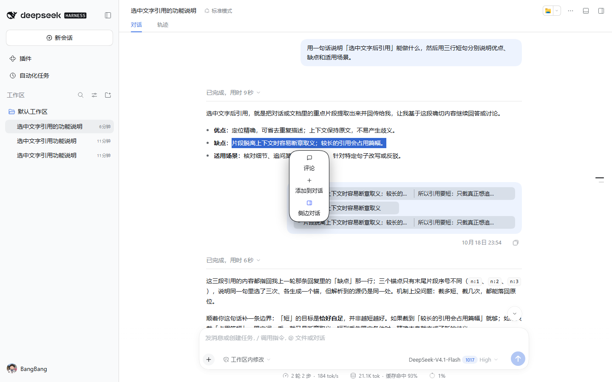
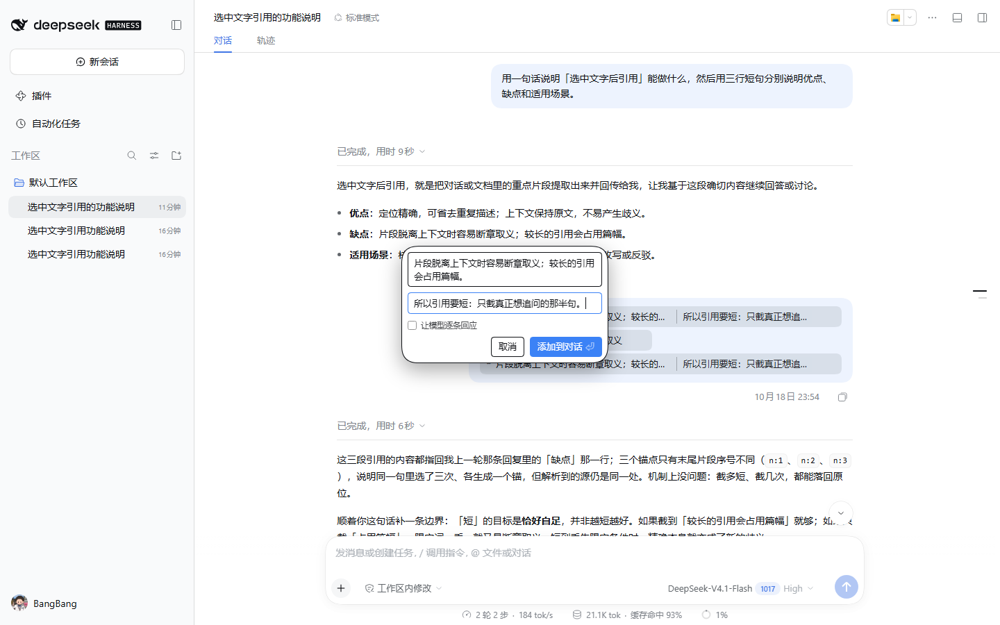
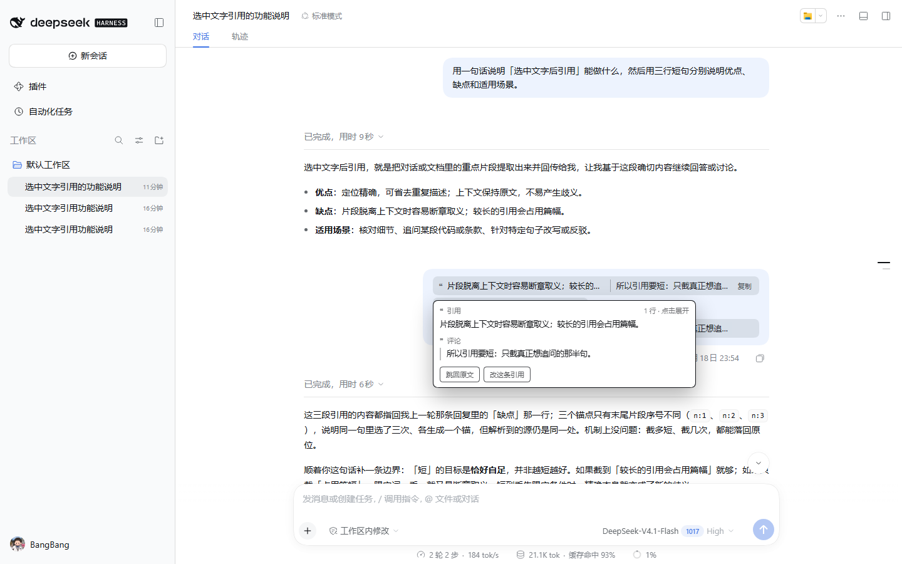
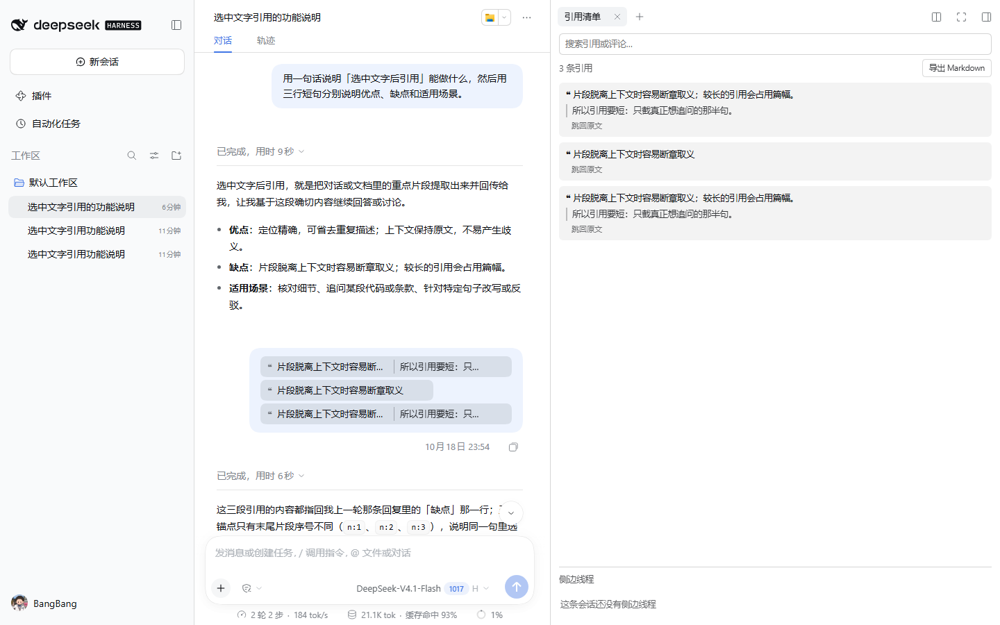
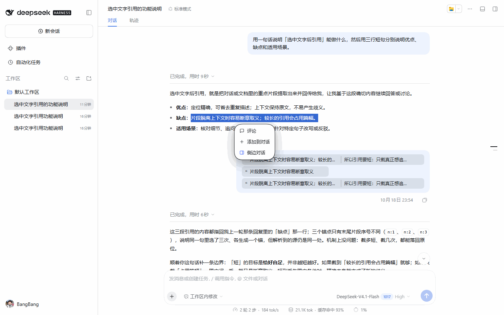

# dsh-client-ui-quote

[](https://www.npmjs.com/package/dsh-client-ui-quote)
[](https://www.npmjs.com/package/dsh-client-ui-quote)
[](https://github.com/BangBang-03/dsh-client-ui-quote/actions/workflows/test.yml)

> 在 DSH 里**选中一句话**，浮出「评论 / 添加到对话 / 侧边对话」：引用以 DSH 原生**引用芯片**进输入框，评论和引用是同一颗节点。
> 发送之后它合成**一颗胶囊**，并在原文留下高亮与序号——可跳回、可复制为 Markdown、可进右侧栏的**引用清单**审阅与导出、可把**侧边线程**的结论带回主会话。
> 所有路径**只写草稿、绝不代发**。

[设计说明](docs/design.md) · [自检细节](docs/testing.md) · [开发与发布](docs/release.md) · [English](docs/README.en.md) · [贡献](CONTRIBUTING.md)

## 30 秒上手

1. 安装：`dsh plugin --profile web add dsh-client-ui-quote`；桌面版在应用内插件页搜索同名包。
2. 在消息、文件预览、终端或 diff 里**选中一段文字**，浮层选「评论」或「添加到对话」。
3. 发送后回原文看高亮，悬停胶囊可**跳回**、可**复制为 Markdown**；右侧栏「引用清单」（桌面 `Alt+L`）可搜索、导出、审阅。

「侧边对话」默认**不需要 `dsh-better-sidebar`**：本插件的宿主半会建一个 `origin: "subagent"` 的隐藏子会话（不出现在会话列表），再把主会话**最近几轮的原话**作为一条**隐性上下文**注进去——模型有背景，侧聊里却不会把整段历史铺出来。页签用本插件自己的 `quote-sidechat` 打开（宿主缺页签注册能力时退回内置 `subagentchat`），引用以**原生芯片**落进它的草稿（宿主没有芯片面时退回块引用），**仍然只写草稿，不替你发送**。宿主半不可用时自动退回 fork + 本插件页签；想优先用 better-sidebar，把 `sideChatBackend` 设成 `"better"`。

选中正文 → 浮层动作 → 引用变成输入框里的行内胶囊（不是纯文本），评论也放在同一颗芯片里；发送之后，引用和评论**合成一颗胶囊**留在消息里，不会摊成一屏 `>` 行。第三项「侧边对话」则把引用写进右侧栏一条**独立的侧边线程的输入框**（一条主会话一条线程，反复点就反复追加），问什么由你写，主会话一点都不动。评论框里**引用正文本身也可编辑**（选多了当场裁）；从**文件预览、终端或 diff**划选的引用以**围栏代码块**的线格式发给模型，模型看到的是真正的代码块。引用落进草稿后，**原句在来源消息里留下高亮与序号**，输入框上方出现 **`引用 ×N`** 的聚合条；发送块里的坐标行前面还带一段人可读的 **`引自第 N 轮 · 助手`**，模型不用解码就知道这段话从哪来。

文中的 `Alt+Q/C/B/L` 仅为桌面默认键位；Web 不提供默认绑定，四个命令仍出现在宿主快捷键设置中，可自行配置。

## 界面

| 划词浮层 | 评论：引用与评论各一格，都能改 |
| --- | --- |
|  |  |

| 发送后的胶囊 + 悬停卡片 | 右侧栏的「引用清单」页 |
| --- | --- |
|  |  |

四张界面轮播（24 秒，静态截图合成，非实时录屏）：



素材说明见 [`docs/screenshots/README.md`](docs/screenshots/README.md)。

## 功能

| 动作 | 行为 |
| --- | --- |
| **评论** | 浮层就地变成评论框（`写一句评论…` + `取消` / `添加到对话`）。评论框里**引用正文也在自己的输入框里、可以改**——选多了就当场裁掉。评论框打开期间，原选区用 Chromium 的 `CSS.highlights` 保持高亮，焦点进了输入框也不会丢参照；不支持该 API 的宿主静默退化，评论框里仍有原文。`Enter` 提交、`Esc` 关闭、引用或评论为空时确认按钮禁用；输入法组合输入不会误触发。 |
| **添加到对话** | 直接把引用加进输入框，不弹评论框。输入框里已经写好的文字会留在原位：引用落到草稿**最上方**，你的文字另起一行接在下面，光标停在末尾，接着写正式提问即可。 |
| **侧边对话** | 把引用写进一条**独立的侧边对话**的输入框。默认走**内置隐藏线程**：本插件的宿主半用 `agents.create` 建一个 `origin: "subagent"` 子会话（会话列表不显示它），主会话最近几轮的原话作为**一条可折叠的隐性上下文**注进去（种子里先落一个空的 `system/message` 作系统头，再放这条上下文，都在一个收口回合里），而不是把整条历史铺出来，用本插件自己的 `quote-sidechat` 页签打开（页体渲染宿主的嵌入式会话，固定聊天态，不画宿主的欢迎页；宿主若仍判 blank，视图区用空态兜底）——聊天记录、输入框、流式输出与工具调用全是 DSH 原生的；宿主缺页签注册能力时退回内置 `subagentchat` 页。宿主半不可用（旧宿主 / 父会话不在线 / 创建被拒）时自动退回 `sessions.fork`（同样是本插件的 `quote-sidechat` 页签）；把 `sideChatBackend` 设成 `"better"` 才优先走 dsh-better-sidebar。**不装 better-sidebar 也有隐藏线程**；装了也不会冲突，两边共享 `Side: ` 持久约定但路由、存储与 descriptor 各自独立。所有后端都**什么都不发送**，线程独立运行、不污染主会话，页签自动在右侧栏打开。同一条主会话只开一条线程，之后每次点都在同一条线程的草稿后面接着追加。鲸鱼蓝（`#4d6bfe`）的图标是它在浮层里的标识。浮层里**只有一项**「侧边对话」——两个长得一样的入口只会让人犹豫；早期版本按引用分过线程的记录仍会被识别并复用。引用清单页底部会列出这个会话的**全部侧边线程**，每条都能重新打开。 |
| **键盘直达** | 桌面端 `Alt+Q` 引用 / `Alt+C` 评论 / `Alt+B` 侧边对话——同一个浮层的三个动作，不弹浮层直接办。走 DSH 的快捷键服务注册，所以出现在设置里、可改键、与宿主键位冲突会在注册时报错；没有选区时返回 `pass`，按键不会被吞掉。 |
| **原文侧高亮** | 引用落进草稿或发出后，被引用的原句回到**来源消息**里留下淡黄高亮与**序号角标**（序号就是坐标里的同句序号，和 `「引用N」` 对得上）。**芯片被移出草稿（没有发送）时，这块高亮与序号一起收回**——不想添加了就不该在原文上留标记；已经作为胶囊发过的引用不受影响。支持 `CSS.highlights` 的宿主由浏览器**直接绘制高亮**，滚动、流式输出、虚拟列表重排都跟手，不靠逐帧重画去追；不支持时才退回浮层矩形（只画序号徽章）。行不在视口里、文字已经变了、宿主不给 `Range` 时就静默跳过，**不改宿主的 DOM**（高亮不包 `mark`，也不搬节点）。表格单元格、表格行、段落、列表项、`<br>` 这些块级边界按浏览器选区报告的 `\t` / `\n` 对齐，所以跨单元格、跨行、跨段落的引用也能画回来。 |
| **聚合引用条** | 输入框上方一条 **`引用 ×N`**：每颗芯片一个摘要胶囊，点一下跳回原文（跳不到就把光标放到芯片上，一次退格删掉），悬停就是完整卡片；每条末尾有 **`✎` 编辑**与 **`×` 移除**：编辑把原引用与评论回填进注释框，确认后旧芯片让位、新芯片原地插入；移除优先走宿主自己的 `consumeToken`（按芯片的 detect 区间与 `draftRev` 做 CAS 精确删除，不会碰错别的文本），宿主没有这个读取面或同名芯片无法区分时才退回「聚焦芯片 + 退格」并提示。**移除（或直接退格删掉芯片）之后，如果这条引用从没真正发出去，原句上的高亮与序号也一起收回**；页面上已经有它发出的胶囊时则照旧保留。**整条索引存在本机**：宿主会跨刷新恢复草稿里的芯片，插件的索引也一起恢复，所以刷新后条、卡片与「打开文件」都还在。主会话与侧边线程各自的输入框各有一条；芯片删光时条自己消失。整条带 `role=toolbar`，每颗胶囊的可访问名是完整引用+评论，不是截断后的标签。 |
| **来源头** | 发送块尾部的坐标行前面多一段人可读的出处：**`※ 引自第 12 轮 · 助手 │q1:…`**，模型不解码也知道来自哪一轮、谁说的；角色属性宿主没给时就只写轮次。胶囊悬停卡片里同样显示 `引自第 12 轮 · 助手`，按界面语言本地化。 |
| **Diff 划选** | 在 diff / 每轮改动面板里划选也走同一个浮层：引用按**代码块**发，围栏信息位带探测到的文件路径与行号（`src/app.ts#L12`）；路径、行号是宿主 DOM 上的探测，拿不到就只带代码，不影响引用本身。有路径时卡片/清单可直接打开文件并定位到起始行。 |
| **清单多选插入** | 引用清单每行一个勾选框，`插入所选` 一次把多条引用写进输入框——每条各成一颗芯片、各自带坐标，不合并；芯片通路不可用时退回一段包含多个引用块的文本。这一栏是只读导航 + 批量插入，不做就地删除——删除与编辑在**草稿上方的聚合条**里做（宿主暴露了按区间消费 token 的 `consumeToken`；旧宿主没有这个读取面时才退回退格路径）。 |
| **审阅工作台** | 清单页把引用当**对象**管：每行一个 **`待处理 / 已解决`** 状态钮（点一下切换，行整体随之变淡），页首的 `只看未解决 (N)` 一键筛出没处理完的；每行可以打 **`#标签`**（回车添加、点 × 移除、点标签按它筛选，页首列出全部标签及数量）；勾选若干行后 `标记已解决 (N)` 批量落章，`插入所选` 批量送回输入框。状态与标签按引用坐标归一键（老引用退回按原文），记在本机 `localStorage`（`dsh-client-ui-quote:v1:quote-meta`，上限 800 条）——跨刷新仍在，不跨设备同步、不进模型上下文；`导出 Markdown` 的标题行会带上 `已解决` 与标签标记，没标过的行输出和从前逐字相同。 |
| **跳回原文** | 悬停卡片底部的 `跳回原文`：把引用当初所在的那条消息**停到视野上方 24px**（和宿主自己跳轮次一样的位置）并闪一下。坐标（消息行锚点 + 轮次 + 同句序号）在插入时**写进消息自己的文本**——一段只在线上存在的 `※ 引自第 N 轮 · 助手 │q1:…` 行（base64url 的 JSON），显示、胶囊、清单导出里都剥掉；它随消息本身走，所以跨刷新、跨窗口、以及清单页里根本没被本插件看着选中的引用都跳得回去。只在**引用自己那条会话的面板里**找，不跨会话误跳；被虚拟列表藏起来的行会让位给同轮次的可见行；压根没挂载的行靠滚动搜索一屏一屏地找出来——先往上找（引用总在比它更早的消息里），一路到顶还没找到就从最新处再来一遍；都找不到就明说（`原文已变`——消息还在、那段文字不在了；或 `原文不在当前视图里`）。 |
| **引用清单** | 右侧栏的一个**页面**：本会话发出去的引用与评论的清单。搜索框按引用/评论过滤、点一条跳回原文、每行可以**单条复制成 Markdown**（粘贴到 PR / issue / 别的会话，带评论与 `引自第 N 轮 · 助手` 出处）、`导出 Markdown` 落一个文件、历史没读完时可 `加载更早的消息`。它作为**页面类型**注册进右侧栏（`ctx.sidebarRightTabs.register`），并在指南页留下一个胶囊作入口；`Alt+L` 同样能打开。数据来自会话自己的事件日志（`ctx.sessions.retain` → `session.eventSource`），不依赖屏幕上有没有那条消息；**本机还留一份索引**：上下文压缩把消息裁掉之后，这些引用仍然列得出来。清单可以导出 **Markdown**（给人读）或 **JSON**（给工具读：版本化的 schema，带每条引用的来源坐标、文件、审阅状态与标签）；每行带着**自己那份坐标**（从消息文本的 `※ … │q1:…` 行读出来），所以没被本插件看着选过的引用也能跳。页面底部还有一行**宿主自检**：芯片精确删除是否可用、侧聊走内置隐藏线程 / fork / better-sidebar，不开控制台就能判断。最底下一行是安静的 `★ 在 GitHub 上 Star` 链接——一个普通 `<a target="_blank">`，不点它就不会打开任何页面，插件自己也不发请求。 |
| **侧边线程回流** | 同一个页面底部是这条会话的**侧边线程**：显示它最后问的那个问题与消息条数，并给两个动作——**`带回主会话`** 把线程最后「问题 + 答案」写成主会话输入框里的草稿（**不发送**，你自己按发送），**`导出 Markdown`** 把整条线程落成一个文件。线程内容同样从它自己的事件日志读；没有线程时这一节只说明「还没有侧边线程」。 |
| **改这条引用** | 悬停卡片里的 `改这条引用`：把那条引用当初的**引用与评论都原样放回评论框**（引用正文、评论各占一个输入框，都能改），你改完按 `⏎` 就发出一条**新的**引用（DSH 没有编辑已发送消息的 API，这是唯一诚实的做法）。旧胶囊随即挂上 **`已修订`** 标记，卡片里直接显示改后的评论；**连正文一起改过的**，卡片里也把改后的原文亮出来。标记按引用原文记在本机，跨刷新仍在。 |
| **逐条回应** | 评论框里的一格**勾选项**（默认关）：勾上，这条引用的块尾就多一行**只有模型读得到的指令**——请按出现顺序把引用记为「引用1」「引用2」…并在回复中逐条对应。**指令随界面语言**：英文界面下要求模型用 `「Quote N」`，模型的回复里 `「引用N」` 与 `「Quote N」` 都会被认成徽章。模型的回复里每个这样的标签会变成一枚**小徽章**：悬停就是那条引用的完整卡片（含 `跳回原文` 与 `改这条引用`），点了就跳；编号超出这条消息引用数的标签保持纯文本。指令行与围栏一样只是**线上形态**，胶囊、卡片、导出里都不出现。 |
- 引用以 DSH 原生行内原子节点 `reference-chip` 插入（带图标的胶囊）；走「评论」时评论一起放进这颗芯片（芯片标签显示为 `引用摘要 · 评论摘要`），引用与评论始终是一体，草稿里不会散成两段。
- **代码引用**：线格式不再是纯块引用，而是 `> ❝ ``` ` / `> 代码行` / `> ``` ` —— 模型看到的是真正的围栏代码块；胶囊与悬停卡片随之换等宽字体、按代码的空白排版，引用清单导出时也落成 ``` 围栏而非 `>`。围栏只是线格式（传输时剥掉），胶囊上显示的仍是原始代码文本；正文里本身就有 ``` 时改用 `~~~` 围栏。**文件预览的引用还带着它出自哪个文件、哪些行**：宿主标了路径（预览头部的路径标签，或 DOM 上的路径属性）时就写进围栏的信息位——`> ❝ ``` src/app.ts#L12-L48`；预览按行渲染时连行号一起带上（GitHub 的 `#L` 写法）。**聊天转写里的代码块划选同样升级为代码引用**：选区两端都在同一个渲染代码块内时，围栏信息位带上渲染器声明的语言（`> ❝ ``` ts`），不再退化成普通块引用；跨出块边界的选区仍按普通引用发。模型由此可以直接读懂语言、打开文件、翻到这几行动手，清单导出的围栏行同样带着它；探测不到就维持原样，什么也不损失。**悬停卡片与引用清单里，这段来源是可点的 `文件预览 · src/app.ts · L12-L48 ↗`**：点一下用 `ctx.sidebarRight.openResource` 打开右侧栏的文档预览，并把 1 起算的起始行作为导航参数交给宿主；同一文件已打开时聚焦原 tab 并送一次新的导航 revision，不另开重复页签。预览打开后，被引的那几行会被标出来（预览自己的行号属性）。**来源有话说**：文件预览、终端、Diff、代码块各有各的标签，读者一眼知道这段话是从哪儿冒出来的。语言标签不是文件，不会出现「打开 ts」这样的死入口。
- **引用正文可以编辑**：评论框上半格是引用自己的输入框（评论在下半格），划选带进了提示符噪音或多选了几行，当场裁掉再发；「改这条引用」时旧正文回填同一格，改完随新引用发出。
- **选区保结构**：在聊天里划选到链接或行内代码时，引用会带上 Markdown 记号（`[标题](地址)`、`` `代码` ``），模型因此知道原文指向哪里；去掉记号的纯文本仍留在本机，**高亮与跳回照样对得上**。没有结构的选区（普通段落）逐字不变。
- **回合级引用**：每条回合的尾部多两个安静的按钮——**引用提问** / **引用回答**：把整轮的提问或回答按原文取出，进同一个评论框（可改、可评论），确认后成为一条带坐标的引用，坐标取自该轮第一行，照样能跳回原文。宿主没有这个槽位时按钮不出现，其它能力不受影响。
- 发送时由 DSH 回调本插件取「模型形态」：**`> ❝ …` 引用行 + 同一个块里的 `> ❞ …` 评论行**。消息里那段块会被就地换成 Kimi 那样的一颗胶囊
  （`❝ 引用摘要 │ 评论摘要`，鼠标移上去就能读到引用与评论的全文、点开可展开、悬停出现 `复制`），你自己写的话保持原样，模型收到的仍是完整引用文本。
- 浮层位置贴着选区**下方**（下方放不下时才挪到上方），配色在运行时从输入卡片 / 正文取样，深浅色主题都适配；中文/英文词条随界面语言切换。
- 芯片插入优先走 shell 的 `insertReference`；宿主只保留 scoped `slash/input-insert-reference` 事件时走事件通道；两者都不可用（拿不到 DSH 的输入触发服务或会话输入服务）才退回纯文本形态：直接写入 `> ❝ …`（评论接 `> ❞ …`）引用块。
- **配置与调试句柄**：本机 `localStorage` 里一组白名单开关（只存本机、不进模型上下文），以及 `window.__dshQuote` 调试句柄——见下节。

## 安装

要求：DSH ≥ 0.2.0-rc.2 的 **web / 桌面** 客户端（`package.json` 里 `engines.dsh` 声明的就是实测版本；插件运行在渲染进程里，headless profile 没有 UI）。

### 方式一：npm 包（推荐）

已发布到 npm：`dsh-client-ui-quote`（0.10.0 起上架；稳定版当前 **0.13.4**）。仓库只有一个 `main` 分支：把 `vX.Y.Z` 标签打在 `main` 头上，CI 就发到 npm 的 `latest` 并建 GitHub Release；`main` 的普通 push 只跑测试，不发布。

```bash
dsh plugin --profile desktop add dsh-client-ui-quote
```

npmmirror 与 npmjs 一般 10 分钟内同步，DSH 配置了镜像源即可国内直装。Electron 托管的 `desktop` profile 也可以在**应用内市场**里搜索本插件安装（`dsh plugin` 对这类 profile 会拒绝管理，这是 DSH 的限制，不是插件的问题）。

安装稳定版：`pnpm install dsh-client-ui-quote@latest`。`@lab` 是已停用的旧预览频道——仍能装到 `0.13.1-lab.61`，但不再更新。

### 方式二：手工注册为 profile 组合包（不用 CLI 时）

1. 把包装进 profile：`cd <DSH_HOME>/profiles/<profile> && pnpm add dsh-client-ui-quote`；
2. 编辑 `<DSH_HOME>/profiles/<profile>/package.json`：
   - `dependencies` 里应有 `"dsh-client-ui-quote": "^0.13.4"`（安装器会写）；
   - `dsh.profile.bundles` 追加 `"dsh-client-ui-quote"`；
3. 重启 DSH（profile 打开 `patchReload` 时也会自动重载）。

**不需要手写 loader 条目**：包自带的 `cordis.patch.yml` 就是组合包层补丁，会插入

```yaml
- insert:
    - id: ui-quote
      name: dsh-client-ui-quote
```

### 方式三：link 本地仓库（只给开发用）

```bash
git clone https://github.com/BangBang-03/dsh-client-ui-quote.git
dsh plugin --profile desktop add link:<clone-path>
```

link 的优点是改完刷新即生效；**日常运行请用方式一**，不要长期挂 link——那样市场/版本号都会绕着走。

### 开发与发布

两种运行方式（`link` / `stable`）、推送通道与发布运维备忘见 [`docs/release.md`](docs/release.md)。断言入口是 `npm test`（**715 项**：check 12 + capsule 493 + panel 163 + host 47），`.github/workflows/test.yml` 在每次 push / PR 上用 Node 18/20/22 各跑一遍。

### 卸载

从 `dsh.profile.bundles` 与 `dependencies` 里移除该条目，重启 DSH（link 安装的包目录可以直接删）。

## 使用

1. 在会话正文、**文件预览**或**终端**里**拖动选中**一段文字（后两者没有自己的会话 id，引用会落进当前屏幕上那条会话，并且以**围栏代码块**的线格式发给模型；输入框内的选区属于改稿，不触发）。
2. 选区**下方**浮出浮层（下方空间不够时才改到上方），选择 **评论**、**添加到对话** 或 **侧边对话**。同一组动作也有键位（**桌面默认**）：**`Alt+Q`** 直接引用、**`Alt+C`** 直接开评论框、**`Alt+B`** 直接开侧边对话（都在设置里可改；Web 没有默认绑定，命令仍出现在设置里；没有选区时按键原样让给其它快捷键）。
3. 前两个动作把引用放进输入框（评论模式下引用与评论在同一颗芯片里；**评论框上半格是引用正文本身，可以当场裁剪**；评论框里还有一格 **`让模型逐条回应`** 勾选项，勾上这条引用就带着逐条指令发出去），页面选区被清除、焦点交给输入框，可以接着写正式提问。输入框里已经有文字时，引用落在**最上方**，你的文字另起一行接在下面。
4. **侧边对话**写的是另一条会话的输入框：右侧栏打开该线程的页签（标题取引用首行），草稿里**只有这条引用**（原生引用芯片优先，宿主没有芯片面时才退回块引用形态），**不发送**；你接着在这条线程里写自己的问题、自己按发送。同一条主会话只会有一条侧边线程，第二次点第三项就把新引用接在草稿后面；上一次请求还在进行时，再次点击会并入第一次，不会开出两条重复线程。线程打开时的上下文是**一条隐性消息**（主会话最近若干轮的文字，按「上下文」折叠显示），所以侧聊里看不到主会话那一长串历史。
5. 浮层收起条件：单击别处、选区清空、按 `Esc`、滚动会话、窗口尺寸变化，以及动作完成之后。双击选词不会把浮层关掉。
6. 发送出去以后，消息里那段块会显示成一颗**胶囊**：收起时是单行 `❝ 引用摘要 │ 评论摘要`，**鼠标移上去**会浮出一张卡片显示完整的引用与评论
   （输入框里那颗芯片同样可以悬停查看），点一下就在原地展开成全文，胶囊上悬停出现 `复制`。
   你自己写的话照旧显示在它下面；一条消息里引用了几处，就会出现几颗胶囊，中间的原话留在原来的位置。
7. 悬停卡片底部有 **`跳回原文`**：只对那些**本插件看着被选中**的引用出现（插入时记下了它所在的消息行 `data-chat-anchor-key` 与轮次），点一下就把那条消息**停到视野上方 24px**——和你用宿主自己的「跳到某一轮」是同一个落点——并闪烁一下。搜索只在这条引用**自己的会话面板**里进行（同一个锚点键在别的会话里也有时不会误跳），被 `hidden` 藏起来的行不算目标、会让位给同轮次的可见行，还没被虚拟列表挂载的行会一屏一屏地滚出来找——**先往上**（引用总在更早的消息里），到顶仍未找到就从最新处**再来一遍**；这套落点是宿主自己的做法：读 `[data-conversation-scroll]` 的 `scrollTop` 再连补几帧（虚拟列表挂载邻居时会改写偏移，一次性的 `scrollIntoView` 会落短）。真找不到时给一条 toast（`原文不在当前视图里`），而不是留一个点了没反应的按钮。
8. **引用清单**：右侧栏的「引用清单」页把这条会话发出去的所有引用与评论列成一张表（**导出 Markdown** 给人读，**导出 JSON** 给工具读；本机还留一份索引，上下文压缩把消息裁掉后清单仍列得出来）——**搜索框**按引用或评论过滤，点某一条就**跳回原文**（和悬停卡片上的按钮同一套落点），右上角**导出 Markdown** 存成文件；历史还没读完时列表上方会出现 **`加载更早的消息`**。入口有两个：右侧栏默认的**指南页**里有它的胶囊（点一下就在当前栏打开），或按 **`Alt+L`**（同样在设置里可改）。
9. **侧边线程回流**：同一个页面底部是这条会话的侧边线程（默认一条主会话一条；早期按引用分线程的记录也会列在这里）——显示它最后问的那个问题与消息条数。**`带回主会话`** 把线程最后的「问题 + 答案」写成主会话输入框里的草稿（**不发送**，你自己按发送；输入框里已有的内容会保留，回流内容接在下面）；**`导出 Markdown`** 把整条线程按顺序落成一个文件。没有线程时这一节只说明「这条会话还没有侧边线程」。
10. **回合级引用**：每条回合的尾部有 **引用提问 / 引用回答** 两个按钮——把整轮的提问或回答按原文取出，进同一个评论框（可改、可评论），确认后成为一条带坐标的引用。
11. **草稿里的引用**：输入框上方的 **`引用 ×N`** 条里，每条都能 `✎` 编辑（回填原引用与评论，旧芯片让位、新芯片原地插入）或 `×` 移除；刷新之后条、悬停卡与「打开文件」都还在。
12. **改这条引用**：悬停一张胶囊卡片，点 **`改这条引用`** —— 评论框把那条引用当初的**引用与评论都填回来**（各自一个输入框，都能改），你改完按 `⏎`（或点「添加到对话」）。发出的是一条**新的**引用：DSH 的消息是只追加的，没有编辑 API，所以「修改」只能这样表达。旧胶囊会立刻挂上 **`已修订`** 标记，它的卡片里显示改后的评论；连正文一起改过的，卡片里也显示改后的原文。标记按引用原文记在本机（`localStorage`），刷新后仍在。

## 配置与调试

开关存在本机 `localStorage` 的 `dsh-client-ui-quote:v1:config`，键名白名单、类型不符或越界的值一律丢弃：

| 键 | 默认 | 作用 |
| --- | --- | --- |
| `minChars` | `1` | 选区短于这个字数就不弹浮层（防误选一两个字）。 |
| `maxQuoteChars` | `4000` | 引用超过这个字数就截断并提示；`0` 表示不限。 |
| `replyByDefault` | `false` | 「让模型逐条回应」是否默认勾上。 |
| `attribution` | `true` | 是否把可读的来源头（`引自第 N 轮 · 助手`）写进发给模型的线格式；关掉后仍保留可跳回的坐标。 |
| `highlight` | `true` | 是否绘制原文侧高亮。 |
| `sideChatBackend` | `"native"` | 侧边对话后端：`"native"`（默认）优先用宿主半的内置隐藏线程，失败后退回 fork + 本插件页签；`"better"` 优先用 dsh-better-sidebar 的侧聊。两种设置都不要求装 better-sidebar。 |

调试句柄在浏览器控制台里可用：

```js
__dshQuote.config()                    // 当前开关
__dshQuote.setConfig({ minChars: 3 })  // 改开关（立即生效，落本机）
__dshQuote.state()                     // 浮层此刻的状态：选区、模式、路径、芯片数
__dshQuote.probe()                     // 宿主服务可见性（inputTriggers / conversation / sidebarRight / betterSidebar…）、索引规模，以及 lastFailure：最后一个失败的环节
```

`probe().lastFailure` 是给排障用的：`stage` 只会是 `source` / `insert` / `remove` / `sidechat` 之一，`detail` 是一句原因（例如「insertReference 与 scoped 事件都拒绝了芯片」），`count` 是这个页面累计次数。它只记阶段与原因，不记引用正文，可以直接贴进 issue。

## 为什么是这一个

本插件相对同类的**可验证**优势集中在四件事上，都有离线断言兜底：

1. **语义而不是机制**：引用与评论是同一颗节点（对齐 Kimi 的 `quote` 节点 `{text, comment}`），一颗芯片 → 一个块 → 一颗胶囊 → 一张卡片 → 一次复制；机制（reference chip、DOM 增强）谁都能抄，这条链子不好抄。
2. **引用是带坐标的活对象**：`跳回原文` 在自己的会话面板里找行、按宿主的方式对齐到 24px，行被虚拟列表藏起来或没挂载都能找回来；坐标以「人可读来源头 + base64 尾巴」随消息走——前者让模型知道出处，后者让插件跨刷新回读。base64 确实占一点 prompt，这是用「不依赖本地表」换来的取舍。
3. **引用有下落**：清单页（搜索 / 跳转 / 导出 Markdown）+ 侧边线程回流（结论写回主会话草稿 / 导出线程），这两件事在同类里仍是少数。
4. **工程化**：715 项离线断言（含真跑 `sessions.retain` / `setDraft` / `agents.create` 参数 / 下载链路）、每个宿主契约都在 README 里写明出处、每个版本都有可回读的 release。同类里做到同等断言规模的仍是少数。

> 完整的同类对照、与 Kimi 的逐条对应、以及「本插件不做什么」都在 [`docs/design.md`](docs/design.md)。

## 已知限制

- **可选服务注册**：引用源和四个快捷键通过 Cordis `ctx.inject` 等待 `inputTriggers` / `shortcuts`，服务提供者卸载时释放旧注册，重载后在新实例注册。DSH 0.2.1-rc.2 的快捷键注册器会校验所有平台默认值，裸 Alt 的 Web 默认值会使整条命令注册失败，因此仅保留桌面默认绑定。

- **隐藏线程的模型路由**（app.asar 0.2.1-rc.3，issue #2 实测）：旧种子里的收口回合从未真正请求过模型，子会话因此没有 `modelSelection` 投影；标准 preset 的 persona 里 `{{model}}` 取不到值，任何一轮都会以 `prompt variable "{{model}}" has no value` 失败。0.13.1 起在 `setup` 里按宿主 `api-session-controller` 的做法装 `system-prompt/assemble` 钩子并 append 一条 `model/selection`；线程重建后是否同样生效取决于宿主是否从投影恢复选择，实测前先按「重建后可能仍需重开线程」理解。
- **内置隐藏线程依赖宿主内部契约**（app.asar 0.2.1-rc.3 实测）：宿主半 `lib/index.js` 用 `ctx.inject(["webServer"])` 注册 `POST /ui-quote/api/sidechat.start`，在宿主服务就绪后从父会话 `snapshotEvents()` 取原话合成一条隐性上下文（不复制日志），再用 `ctx.get("agents").create({ meta: { parentSession, isSeeded: true, origin: "subagent", delegationDepth, agentPreset }, seed, inheritedEventCount, agentOptions, setup })` 建子会话；descriptor 为 `{version: 3, mode: "continuable", provider: "ui-quote", label}`，标题 `Side: <引用首行>`。`webServer` / `connection.requestRejection` / `agents` 缺失时探针失败，客户端退回 fork；`agents.create` 失败只影响这一条线程。
  **种子不复制父会话日志，只带一条隐性上下文**：`seed` 固定八个事件（带模型选择时九个）——`session/end-seed { inherited: true }`（切点在下标 0）、一个**收口回合**（`turn/start` → `step/start` → **空内容的 `system/message`** → 上下文消息 → `step/end` → `turn/end{done}`）、以及 `subagent/descriptor`（再加一条可选的 `model/selection`）。**回合的第一条必须是 system 消息**：会话存储把第一个 surface 节点当作受保护的系统头；任何在它之前出现的其它 surface 节点（比如把上下文直接放最前）都会让首个真实回合的 `system/message` 在重载时报 `system/message requires a protected first surface head`，之后每次发送都以 `subagent/not-resumable` 失败——v4 的回合缺这个头、v5 干脆没有回合，都栽在这里。空 system 消息是宿主自己的空提示形状；首个真实回合会替换它，或在其后追加自己的系统提示。那条消息里是主会话最近若干轮的**纯文本**（用户/助手、上限 8000 字，工具调用与注入上下文都跳过），带一句「只作背景、别继续执行」的指令——所以模型仍有上下文，侧聊界面把它折叠成一行「上下文」，不会把整段主会话铺出来，也不再为复制整条日志付一遍 token。宿主读子会话身份时走 `subagent` 投影（最后一次 descriptor 生效），并在 `api-session-controller` 里要求 `identity.seq >= inheritedEventCount`，否则整个子会话的历史都打不开（`subagent/catalog-diagnostic` · "subagent descriptor is unavailable"）——descriptor 必须排在切点之后，0.12.3-lab.26 就是栽在这一步。
  **旧线程靠形状版本戳识别，不靠 `sessions.retain`**：retain 对这类坏线程**照样成功**（只有历史 RPC 会拒），所以客户端给新建的线程在 `dsh-client-ui-quote:v1:sidechat-target` 里盖当前形状版本（现在是 `v: 6`：收口回合 + 空 system 头 + 隐性上下文 + 自营页签），只复用自己盖过章的线程；better-sidebar 的、旧版本的、清单里扫描发现的线程一律丢弃重建——点一次就自愈，代价是最多重建一条线程。隐藏线程是 `continuable` 子会话，**父会话在线时可继续**；父会话关闭后是否还能写由宿主对 `continuable` 子会话的规则决定（通常只读），重新打开父会话即可继续。宿主升级改了 `agents.create` / 种子格式时，线程创建会失败并自动退回 `sessions.fork`，不会白屏或报错。
  **自营页的 hero 契约**（app.asar 0.2.1-rc.3，`ui-conversation` 的 `ConversationContent` 实测）：`hero` 为真时宿主渲染欢迎页（「探索未至之境」）与 hero 输入条，未选工作区时输入条禁用——引用芯片无处可落。自营页固定 `hero: false`、phase 走 `settling → active`。v6 种子自带收口回合，子会话通常不是 `blank`；宿主若仍把它判成 `blank`（例如旧宿主忽略了种子里的回合），`ConversationSession` 会返回 null，视图区没有 DOM、输入条会被排到页签栏下方——所以自营页的视图槽仍带一个空态块（有回合后自动隐藏），把输入条留在页底。
  想优先用 dsh-better-sidebar（实测 0.28.0）的侧聊 UI，把 `sideChatBackend` 设成 `"better"`；它仍走自己的 `POST /sidebar/api/sidechat.start`，父会话未运行时会收到 409。两边共享 `Side: ` 标题约定，装不装都不会互相抢自动打开的焦点。
- **「改这条引用」是追加，不是原地编辑**：DSH 的 transcript 只追加（侦察确认全树没有 `editMessage` / `updateMessage` / `rewriteMessage` / 回收 API，只有**尚未进入会话**的队列条目可改）。所以修订发出一条新引用（评论、引用正文都可改），旧胶囊只挂 `已修订` 标记——标记存在**本机** `localStorage`（`dsh-client-ui-quote:v1:quote-revised`，按 **`ref + 引用原文`** 归一键、上限 60 条），同一句话从两个不同位置引用时互不影响；没有 ref 的旧引用仍按原文键读写。它不会跨标签页、跨设备同步，也不进入模型上下文；模型看到的是那条改后的新引用。正文改过后键仍是旧原文：`已修订` 挂在**旧**胶囊上（它的卡片里显示改后的原文与评论），改后的新胶囊不挂标。
- **代码引用的识别靠首行围栏**：块首是 `> ❝ ``` `、块尾有配对的收尾围栏时，这块按代码解析（围栏剥掉、胶囊等宽）。因此一条**普通**引用如果正文恰好以 ``` 或 `~~~` 开头（比如在 Markdown 文件预览里引用了源码），只要它没有配对的收尾围栏，就仍然按正文读回——首行不会被当成围栏吃掉，引用与清单里都是原文。写成代码引用时收尾围栏始终成对，所以正文自带 ``` 的代码引用改用 `~~~` 也不会与这条规则打架。
- **标记形状的正文会被转义**：一行以 `❝` / `❞` / `※` 或反斜杠开头时，写入线格式前加一个反斜杠、回读时还原。因此引用一段本身含 `❞` 或 `※ │q1:` 形状的文档，不会再被当成评论分隔符或坐标行截断/丢行；旧版本发出的消息没有这层转义，仍按旧规则解析。
- **文件预览的路径与行号是探测来的**：路径优先读宿主预览头部的路径标签（`[data-textpreview-path]` 的 `title`，实测 0.2.0-rc.2 的侧栏文档预览就是这个形状），其次探一组候选属性；行号只在预览按行渲染时可得（`data-textpreview-line`，纯文本视图有、高亮代码视图没有）。两者都拿不到就不带（引用形态与从前完全一样）；终端来源的引用没有路径可言。路径与行号写进围栏信息位，`sanitizePath` 把带空白或围栏字符的值挡掉。有路径时卡片/清单会显示并打开它；**Markdown 预览不提供源码行锚点**，打开后不会滚到行，切到纯文本/代码视图后再导航。导航只用起始行，行范围的结束行只用于显示。
- **聊天代码块的识别也依赖宿主 DOM**：选区两端都在同一个 `pre` 里才算代码块，语言从 `code`/`pre` 的 `language-*`/`lang-*` class 或 `data-language` 属性读；宿主换了渲染形状（不用 `pre`、语言标在别处）时，划选安静退化成普通块引用——引用本身不丢，只是少了围栏和语言。宿主若在 `pre` 里渲染行号沟槽，选区带进来的行号文本要靠评论框当场裁掉。
- **Diff 引用的路径与行号同样是探测来的**：先在 diff 卡片里找 `data-diff-path` / `data-file-path` / `data-diff-file` 等头标签（优先读 `title`），再退回祖先属性；行号读 `data-line-number` / `data-diff-line` / `data-line`。宿主换一套 diff DOM 时只会丢路径/行号，引用本身仍按代码块发。
- **多选插入按清单当前顺序写**：每条引用各成一颗芯片；宿主编辑器拒绝 chip 写入时整批退回一段文本块，不会重复插入已成功的条目。搜索框一变就清空勾选，避免“看不见的选中项”被插进去。
- **回复徽章依赖模型守格式**：模型没按指令输出 `「引用N」` 就没有徽章——无损，只是少了联动；输出越界的编号（数错了）保持纯文本。徽章的编号以回复**之前最近的一条带胶囊的消息**为准；切分的是助手消息的文本节点，DSH 若改了助手消息的渲染形态，徽章增强器要跟着调（与胶囊的 `isQuoteRun` 同一条既有限制）。
- 依赖 DSH 客户端的内部接口（`conversation.input.overlay` 槽位、`inputTriggers.registerSource`、`conversation.input.shell(id).insertReference` / `consumeToken`、scoped `slash/input-insert-reference`、`sessions.fork` / `sessions.retain(address)`、`sidebarRight.openResource`、`resources.register`、`SessionProvider` / `conversation.content` 的 embedded 视图、`reference-chip` 节点），以及宿主半的 `webServer.register` / `connection.requestRejection` / `agents.create` / `subagent/descriptor` 种子格式；DSH 升级有可能失效，失效时各后端按上面的回退链降级。
- **引用清单页依赖右侧栏的两个服务**（`sidebarRightTabs` 与 `sidebarRight`，实测 0.2.0-rc.2）；宿主没有它们时页面不注册、`Alt+L` 给一条 toast
  （「引用清单打不开：右侧栏服务不可用」）而不是报错。它的数据来自会话事件日志，**历史是分页的**：只列已加载的消息，更早的要按 `加载更早的消息`；
  如果会话做过原生上下文压缩/裁剪，被裁掉的那些消息里的引用也不会出现在清单里。导出是浏览器下载（宿主没有给客户端插件写盘接口），
  文件名形如 `quotes-<sessionId>.md`；一行能不能跳看它自己带不带坐标——本版本发出的引用都带，更早发出的老引用没有坐标，那行只能当文本读。
- 仅 web / 桌面 profile；选区必须落在会话正文、文件预览、终端或 diff 里（输入框内的选区属于改稿，不触发）。
- 引用在输入框里显示为胶囊，编辑器中复制粘贴出去的是它的模型形态文本。
- transcript 胶囊是在 DSH 渲染结果之上做的覆盖层：它只隐藏原节点、不搬移 React 的节点，但若 DSH 改了消息的 DOM 结构
  （`[data-conversation-content]`、纯文本 run 的形态），需要跟着改 `isQuoteRun` / `capsuleFor`。
- 收起状态的胶囊是**单行**：很长或分段的引用与评论会被省略号截断 —— 鼠标悬停会浮出完整内容，也可以点一下直接在原地展开。
- 更新**之前**发出的老消息不会被变成胶囊：它们的文本里没有 `❝` 标记，插件无从辨认（重新引用一次即可）。
- **原文高亮用完整引用文本定位**：页面刚刷新、那颗胶囊还没渲染时，插件手里只有坐标表里的前 120 字身份键，长引用会先亮前 120 字；胶囊进入视口后补上全文并自动重画。行不在视口、被虚拟列表收起、或文字已经变了就不画，绝不改宿主 DOM。支持 `CSS.highlights` 时高亮由浏览器绘制（跟手、不逐帧追滚动），不支持时退回浮层矩形；两种模式都不包 `mark`。
- **侧边对话的坐标要等它真的发出去才落色**：第三项存坐标时带 `draft` 标记，`paintAnchors` 跳过它，所以原文上不会先亮一块——放弃或关掉侧边对话都不留痕迹。转正靠胶囊：那句引用以胶囊形态出现在某条 transcript（同一个 ref）时才 `promoteSource` 并补画。因此**在另一个窗口**里把侧聊引用发出去时，本窗口要等下一次刷新（重新读 `localStorage` 里的表）才会补上这块高亮，而不是立刻出现。
- **草稿里的芯片删掉后，原文标记会跟着收回**：主会话「添加到对话 / 评论」写进草稿的坐标以 `chip` 记在表里；聚合条的 `×` 或直接退格让芯片离开草稿、而页面上又没有它发出的胶囊时，坐标转成 `draft`（同样的跳过规则），高亮与序号随即收起，落库后刷新也不会复活。已经作为胶囊发出去过的同一段文字不受影响。收回是**按草稿卡片观察**的：整个输入框离开页面（切会话）不算删除；**在另一个窗口**里删掉的芯片，本窗口要等下一次刷新（重新读表）才收回。**两条兜底**：发送后消息先以纯文本出现、胶囊还没增强的那一瞬，收回前会先看 transcript 文本里有没有这句的 `│q1:` 坐标，有就不当成删除；万一转正漏在收回之后、坐标卡在 `draft`，下一次重画只要看到它的胶囊还在页面上，就会把它转正并补画（不再需要重新引用一次）。
- **跨消息的选区不带来源头**：选区起点与终点落在不同消息行时，引用照常发出（原文、评论、代码形态都在），但不写 `引自第 N 轮 · 助手`，也不带可跳回的坐标——一句话横跨两轮时，任何单一轮次都是错的。想要带来源，就分两次引用。
- **没加载插件的窗口会看到引用原文**：消息里存的是纯文本线格式（`> ❝ … │q1:…`），胶囊是客户端插件画上去的增强层，所以**没有启用本插件的客户端**（另一个 profile 的浏览器、插件被停用的窗口、或刚重载还没装上插件的页面）会原样显示这段线格式——这是设计上的兜底，消息和坐标都没有坏。插件加载时会全量重扫一遍已渲染的 transcript，窗口**重新可见或获得焦点**时也会再扫一次（`rescanCapsules()`），把加载缝隙里漏掉的已发引用重新做成胶囊；如果刷新很久后仍原样显示，先查那个窗口的插件是否启用，而不是重新引用一次。
- **评论框期间的原选区高亮依赖 `CSS.highlights`**：Chromium/Electron 支持；不支持时静默跳过，评论框里仍有引用正文，不影响引用本身。
- **聚合引用条的移除与编辑优先用宿主的 `consumeToken`**（实测 DSH 0.2.1-rc.2 的 conversation shell）：宿主把每个芯片投影成一条 occurrence（`offset`/`length`/`label`/`source`），`consumeToken({kind:"span", span:{start,end,draftRev}})` 在 `draftRev` 仍是当前版本时精确删掉这段区间；本插件据此计算 detect 区间（芯片在前面的 occurrence 会把坐标左移 `length - 1`）并带上紧跟的一个空格。宿主没有 `compose()`/`consumeToken`（旧版）或两条同标签芯片无法区分时，才退回「聚焦芯片 + 派发一次 Backspace」；两步都不成功时提示手动按一次退格，绝不做半删除的草稿。`✎` 编辑走同一条移除路径——旧芯片先让位，新芯片再原地插入。草稿芯片的索引存在本机（`dsh-client-ui-quote:v1:chip-index`），所以**刷新后**条、悬停卡与「打开文件」都还在——宿主本来就会恢复草稿里的芯片，索引跟着恢复，它们才重新算是本插件的引用。

- **回合级引用依赖宿主的回合尾槽位**：宿主把每条回合的尾部做成一个列表子槽位（`conversation.chat.turnTail`，`kind:"list"`、`scope:"session"`），本插件往里加一条。宿主没有这个槽位时按钮不出现——功能缺失，其它能力不受影响。
- **引用清单的本机索引只在本机**：它兜的是「上下文压缩把消息裁掉」这一种丢失，记录不进模型上下文、不跨设备、不跨浏览器；没读过的引用它当然也不知道。
- **侧边对话有一条内置主路 + 三条退路**：默认是宿主半创建的内置隐藏线程（`origin: "subagent"` + 本插件 `quote-sidechat` 页，会话列表不显示）；父会话不在线 / 宿主半不可用时退回 `sessions.fork` + 本插件 `quote-sidechat` 页签（线程作为普通 fork 出现在会话列表）；再不行才走 dsh-better-sidebar（仅显式 `sideChatBackend: "better"` 或最后兜底）。隐藏线程与 better-sidebar 共享 `Side: ` 标题约定，所以两边的线程列表可以互相看见，但存储键、路由与 descriptor provider 各自独立。未在侧聊里提问前执行「带回主会话」，可能取到复制过来的最后一轮，先在侧聊里问一句即可。所有后端都不可用时浮层里没有侧边对话那一行。

## 自检

```bash
node --check lib/client.js
npm test          # check + capsule + panel + host，715 组
```

合计 **715 组**（check 12 + capsule 493 + panel 163 + host 47），`npm test` 全绿。四套断言各自覆盖什么、真浏览器版（51 项）怎么跑、坑在哪，见 [`docs/testing.md`](docs/testing.md)。

## 贡献

PR 目标分支是 `main`，标题写成 `fix(quote): 中文说明` 这类口径（合并方式是 squash，**PR 标题会直接变成主干提交的标题**），描述会变成提交正文。提交前跑 `node --check lib/client.js && npm test`。完整规则见 [`CONTRIBUTING.md`](CONTRIBUTING.md)，红线见 [`AGENTS.md`](AGENTS.md)。

## 变更记录

见 [CHANGELOG.md](CHANGELOG.md)。

## License

[MIT](LICENSE)

---

**English**：全文见 [`docs/README.en.md`](docs/README.en.md)。
