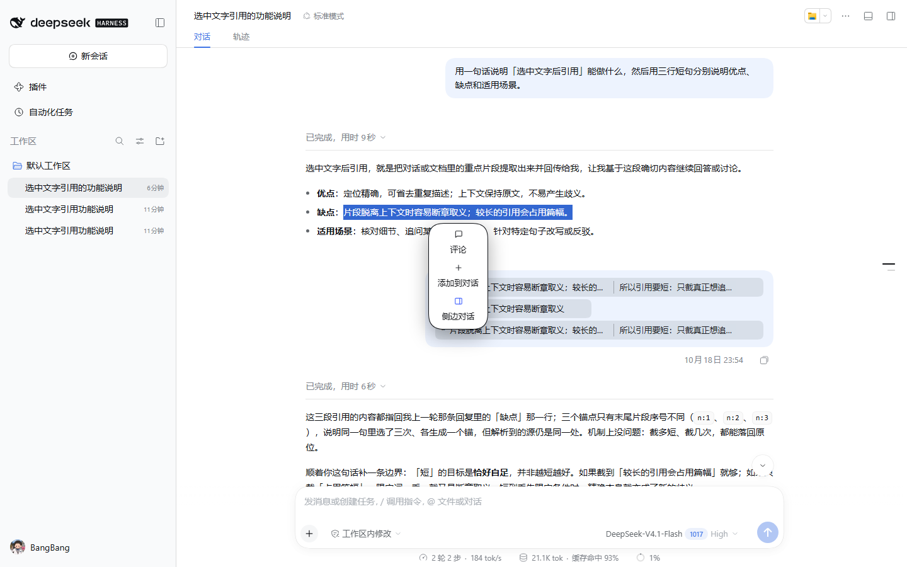
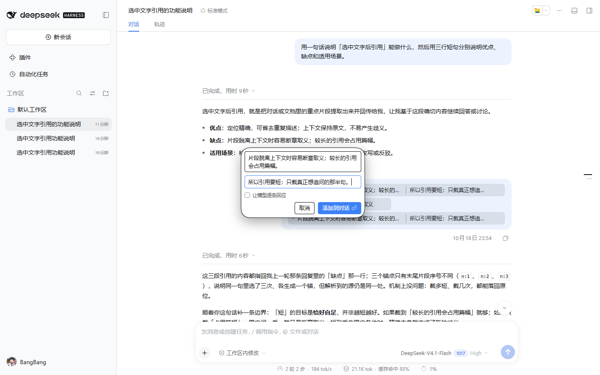
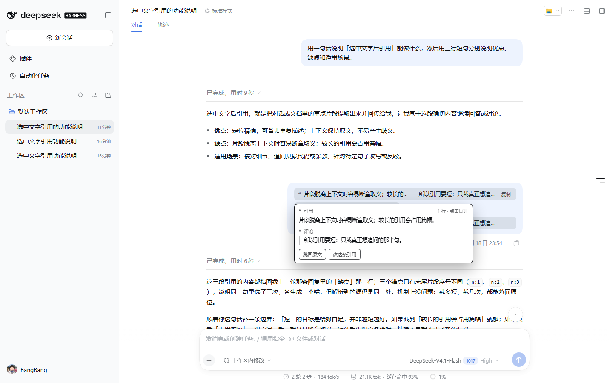
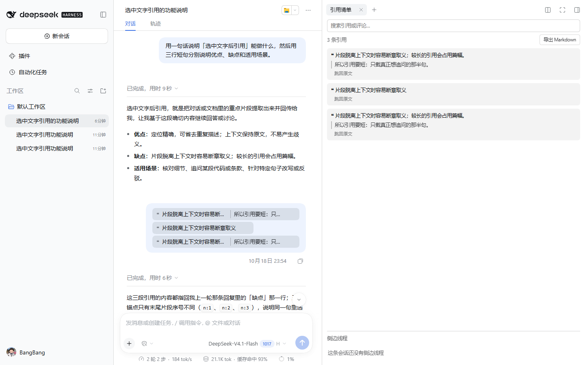
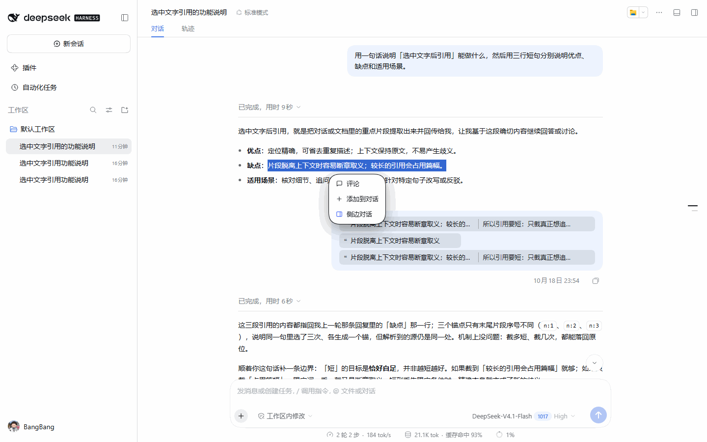

# dsh-client-ui-quote — English

**English** · [简体中文](../README.md) · [Design](design.md) · [Testing](testing.md) · [Release](release.md) · [Contributing](../CONTRIBUTING.md)

[](https://www.npmjs.com/package/dsh-client-ui-quote)
[](https://github.com/BangBang-03/dsh-client-ui-quote/actions/workflows/test.yml)

> **Select a sentence** in DSH and the floating bar offers **Comment**, **Add to chat** and **Side chat**. The quote enters the composer as DSH's native `reference-chip`; after sending it becomes **one capsule** in the transcript and leaves a highlight plus an ordinal on the source sentence.
> From there you can jump back, copy it as Markdown, search / review / export it in the right sidebar's **Quote list**, or carry a **side thread**'s conclusion back into the main draft.
> **Every path only writes a draft — the plugin never sends for you**, and quote content never leaves the machine.

## 30-second start

1. Install: search `dsh-client-ui-quote` in the in-app plugin market, or run `dsh plugin --profile desktop add dsh-client-ui-quote`.
2. **Select text** in a message, file preview, terminal or diff, then choose **Comment** or **Add to chat** in the bar.
3. After sending, look at the highlight on the source; hover the capsule to **jump back** or **copy as Markdown**; the **Quote list** in the right sidebar (desktop `Alt+L`) searches, exports and reviews.

## Screenshots

| Floating bar | Comment: quote and comment are both editable |
| --- | --- |
|  |  |

| Sent capsule + hover card | The Quote list page in the right sidebar |
| --- | --- |
|  |  |

Four-screen carousel (24 seconds, stills, not a screen recording):



Asset notes: [`screenshots/README.md`](screenshots/README.md).

## Features

| Capability | What it does |
| --- | --- |
| **Floating bar** | Comment / Add to chat / Side chat under the selection, positioned against it, colours sampled from the host, light and dark themes both fine. Copy follows the UI language (zh / en / ru). |
| **Comment** | The bar turns into a comment box in place: the quoted text and the comment each get an editable field; `Enter` submits, `Esc` closes, an empty half disables confirm; optional **Ask for per-quote replies**. |
| **Add to chat** | The quote goes to the top of the draft, text you had already typed continues on a new line, caret at the end. |
| **Side chat** | Writes the quote into one independent side thread per main session. By default the host half builds a hidden `origin: "subagent"` child session with one implicit context message; if the host half is unavailable it falls back to `sessions.fork`, and `sideChatBackend: "better"` prefers dsh-better-sidebar. **No backend sends anything.** |
| **Chips and the Quotes ×N bar** | Quotes are native inline chips; the toolbar above the composer jumps back, edits (`✎`) and removes (`×`) each one, preferring the host's `consumeToken` and falling back to focus + Backspace. |
| **Sent capsule** | Quote and comment collapse into one capsule in the message; hover for the full card, click to expand, copy from the card; several quotes in one message give several capsules with the rest of the text untouched. |
| **Source highlight and jump-back** | The source sentence keeps a highlight and ordinal, **retired when that turn's reply completes** (`keepHighlight: true` keeps them). **Jump back** parks the source message 24px from the top and flashes it. |
| **Quote list** | A right-sidebar page: search, jump back, copy one row / **Export Markdown** / **Export JSON**, Open / Resolved plus `#tags`, bulk insert, and side-thread bring-back with a host self-check at the bottom. |
| **Revise and per-quote replies** | **Revise this quote** appends a new quote and marks the old capsule **Revised**; with per-quote replies on, `「Quote N」` in the answer becomes a hoverable badge that jumps back. |
| **Sources** | Messages, file previews, terminals, diffs and rendered chat code blocks are all selectable; code-like sources travel as fenced code blocks, and previews / diffs also carry a detected path and line range that the card can open. |
| **Keyboard** | Desktop defaults `Alt+Q` quote, `Alt+C` comment, `Alt+B` side chat, `Alt+L` quote list, all rebindable in Settings. Web builds have no default binding but the commands are listed. |

## Install

Requires a **DSH ≥ 0.2.0-rc.2 web or desktop client** (`engines.dsh` is a lower bound only, re-checked on 0.2.2-rc.1). Current stable: **0.14.2**.

```bash
dsh plugin --profile desktop add dsh-client-ui-quote
```

For development use `dsh plugin --profile desktop add link:<clone-path>` so a refresh picks up edits; run the npm package day to day. Manual profile registration, uninstall and the release flow are in [`release.md`](release.md).

## Layout

| Path | Purpose |
| --- | --- |
| `lib/` | The two entry points: `client.js` holds every client feature, `index.js` is the host half that only creates hidden side threads. See [`../lib/README.md`](../lib/README.md). |
| `locale/` | Plugin-card metadata for zh / en / ru; in-plugin strings live in the dictionaries inside `client.js`. See [`../locale/README.md`](../locale/README.md). |
| `test/` | Four offline suites (776 assertions), the DOM shim and the real-browser page. See [`../test/README.md`](../test/README.md). |
| `docs/` | Design, testing, release, distribution and this English page. See [`README.md`](README.md). |
| `docs/screenshots/` | Screenshots and the carousel GIF used above. See [`screenshots/README.md`](screenshots/README.md). |
| `skills/` | Agent workflows kept in the repo (docs sync / release); not published to npm. See [`../skills/README.md`](../skills/README.md). |
| `submission/` | Marketplace submission metadata. See [`../submission/README.md`](../submission/README.md). |
| `.github/` | CI / publish workflows and the PR template. See [`../.github/README.md`](../.github/README.md). |
| Root | `package.json` (manifest + `files` whitelist), `cordis.patch.yml` (bundle patch), `icon.svg`, `AGENTS.md` (red lines + routing tables), `CONTRIBUTING.md`, `CHANGELOG.md`. |

## Configuration

Switches live in local `localStorage` under `dsh-client-ui-quote:v1:config`; keys outside the whitelist, wrong types and out-of-range values are dropped.

| Key | Default | Effect |
| --- | --- | --- |
| `minChars` | `1` | Selections shorter than this do not open the bar. |
| `maxQuoteChars` | `4000` | Truncate longer quotes with a notice; `0` means no limit. |
| `replyByDefault` | `false` | Whether **Ask for per-quote replies** starts checked. |
| `attribution` | `true` | Whether the readable source head (`from turn N · assistant`) goes into the wire format. |
| `highlight` | `true` | Draw the source-side highlight. |
| `keepHighlight` | `false` | Keep the highlight and ordinal after the turn's reply completes (coordinates always survive). |
| `sideChatBackend` | `"native"` | `"native"` prefers the host half's hidden thread, `"better"` prefers dsh-better-sidebar; neither requires better-sidebar. |
| `language` | `"auto"` | `"auto"` follows the host, or pin `"zh"` / `"en"` / `"ru"`. |

Debug handle `window.__dshQuote`: `config()`, `setConfig({...})`, `state()` and `probe()` (host services plus `lastFailure`, which records only stage and reason — never quote text — so it can be pasted into an issue).

## Self-check

```bash
node --check lib/client.js
npm test          # check + capsule + panel + host, 776 assertions
```

**776 assertions** (check 12 + capsule 554 + panel 163 + host 47) must be green; `.github/workflows/test.yml` runs them on Node 18 / 20 / 22 for every push and PR, and the real-browser page `test/capsule.html` has 51 more. Details in [`testing.md`](testing.md).

## Known limitations

- **DSH compatibility is an open range**: `engines.dsh` is `>=0.2.0-rc.2`, a lower bound only (re-checked on 0.2.2-rc.1). When the host changes internal interfaces the plugin degrades silently — after an upgrade run `npm test` and one side-chat probe. **Never add an upper bound**; the next rc would disable the plugin outright.
- **Host internal contracts** (first measured on app.asar 0.2.1-rc.3, re-checked on 0.2.2-rc.1): the client relies on `conversation.input.overlay`, `inputTriggers.registerSource`, `insertReference` / `consumeToken`, scoped `slash/input-insert-reference`, `sessions.fork` / `sessions.retain`, `sidebarRightTabs` / `sidebarRight.openResource`, `reference-chip` and `conversation.chat.turnTail`; the host half relies on `webServer.register` / `connection.requestRejection` / `agents.create` / `subagent/descriptor` v3. Anything missing degrades along the fallback chain instead of breaking the plugin.
- **The hidden-thread seed shape is a hard contract**: one closed turn (`turn/start` → `step/start` → empty `system/message` head → implicit context → `step/end` → `turn/end`) plus `subagent/descriptor`; the first surface node must be the system head and the descriptor must come after the inheritance cut, or history cannot load (`subagent/not-resumable`). A shape version stamp keeps the client reusing only threads it created.
- **Revise is append-only**: DSH's transcript cannot be edited in place, so revising sends a new quote and marks the old capsule **Revised** (local `localStorage`, keyed by `ref + quote text`, cap 60).
- **The wire format only grows**: `> ❝ …` / `> ❞ …` / `> ※ 指令：…` / `> ※ 引自第 N 轮 · 助手 │q1:…`. Marker-shaped body lines are escaped; old messages without the escape layer still parse. Code quotes are recognised by the opening fence, which must be paired with a closing one.
- **Paths and line numbers are DOM probes**: when the host does not mark them, they are simply absent; the quote itself is unaffected. Markdown previews have no source-line anchor.
- **Selections spanning two messages carry no source head**: they are sent as usual but without `from turn N` and without a jump-back coordinate.
- **Highlights rely on `CSS.highlights`**: where supported the browser paints them (tracking scroll and streaming); otherwise a fixed overlay draws just the ordinal. Rows outside the viewport, changed text or a host without `Range` degrade silently, and host DOM is never modified. Without the turn-tail slot the highlight simply stays on.
- **Our overlays sit between host layers**: the host settings backdrop is `z-index:1000` and the host toast 1100 (the `dsh-web-frontend` asset CSS on 0.2.2); the aggregate bar, quote bar, toast and hover card stay at 980–983, so a settings panel is never covered. If the host changes its scale, only the stacking order moves, not the quote itself.
- **Side chat and the main session do not share memory**: the thread only carries a snapshot of recent turns (8000 character cap). Bringing an answer back is a manual action in the Quote list (writes a draft, never sends).
- **The Quote list reads the event log plus a local index**: history is paged, older quotes need **Load older messages**, and quotes cut by context compaction are covered only by the local index (same machine, no sync). Without the right-sidebar services the page is not registered and `Alt+L` only shows a toast.
- **Windows without the plugin see the wire text**: the capsule is a client-side enhancement, so another profile or a window where the plugin is disabled shows `> ❝ …` verbatim; the plugin rescans on load and on window wake.
- Web / desktop profiles only; selections inside the composer count as editing and do not trigger; a collapsed capsule is single-line, so long quotes are ellipsised (hover or expand for the whole thing).

Full host contracts, fallback chains and design trade-offs: [`design.md`](design.md).

## Contributing

PRs target `main`; title them `fix(quote): …` (squash turns the PR title into the trunk commit title) and run `node --check lib/client.js && npm test` before pushing. Rules in [`../CONTRIBUTING.md`](../CONTRIBUTING.md), red lines in [`../AGENTS.md`](../AGENTS.md), history in [`../CHANGELOG.md`](../CHANGELOG.md).

## Licence

[MIT](../LICENSE)
